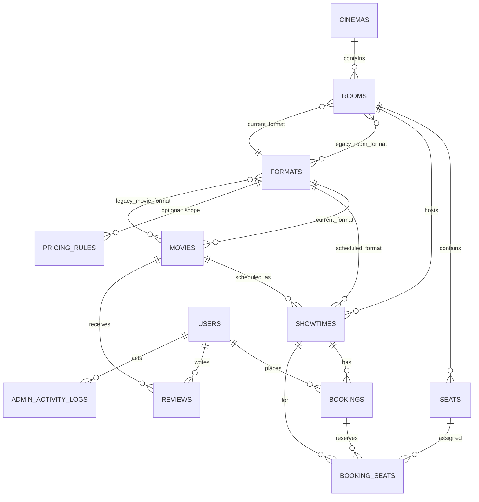

# Báo cáo khảo sát YUNFLIMS Cinema — Giai đoạn 0

**Ngày khảo sát:** 13/11/2026  
**Phạm vi:** Đọc cấu trúc ứng dụng, migration, model, route, controller, middleware, service, view, CSS/JavaScript, seeder, lệnh Console và test hiện có. Không chỉnh sửa mã nguồn, không chạy migration hay seeder.

## 1. Tóm tắt điều hành

YUNFLIMS hiện là ứng dụng Laravel 12 có luồng website đặt vé cơ bản đã được triển khai đáng kể: danh mục phim, rạp/phòng/ghế, suất chiếu, lọc lịch chiếu, kiểm tra Single Seat Rule, giữ ghế tạm, tính giá phía máy chủ, booking chờ thanh toán và khu vực quản trị. Định dạng 2D/3D/IMAX và thời lượng phim đã được dùng để kiểm tra lịch.

Đây chưa phải hệ thống sẵn sàng vận hành thương mại: luồng thanh toán của khách hiện chủ động từ chối xử lý, không có giao dịch/hoàn tiền riêng; xác minh QR chỉ xem trạng thái booking, chưa có check-in một lần; phân quyền mới chỉ có `admin`/`customer`; và một số hành vi quan trọng còn dựa vào logic ứng dụng thay vì ràng buộc DB.

**Xác minh:** 19 migration được báo là đã chạy; `php artisan test --compact` đạt **45 tests, 424 assertions**. Đây là kết quả trên cấu hình hiện tại, không chứng minh được kiểm thử đồng thời nhiều tiến trình hay mọi lược đồ production đều không drift.

## 2. Cấu trúc hệ thống

- **Backend:** PHP 8.2+, Laravel 12, Eloquent, Blade; `routes/web.php` khai báo route website và admin.
- **Database:** MySQL; lệnh kiểm tra chỉ đọc nhận diện MySQL 8.0.30. Migration mô tả schema, còn `migrate:status` xác nhận các migration đã ghi nhận trạng thái `Ran`.
- **Frontend:** Blade, Bootstrap 5.3.3 và Bootstrap Icons được tải từ CDN trong layout; CSS/JavaScript ứng dụng đi qua Vite (`resources/css/app.css`, `resources/js/app.js`). Một số trang còn có CSS/JavaScript inline.
- **QR:** `endroid/qr-code`, QR SVG chứa URL xác minh booking.
- **Tổ chức mã nguồn:** 12 model, 3 service, controllers website/admin, 3 middleware ứng dụng, 19 migration, 3 seeder, một lệnh tạo lịch thử, 44 Blade view, CSS/JS Vite và bộ test Unit/Feature. `vendor/`, `node_modules/`, build output và log không phải mã nguồn nghiệp vụ.
- **Giao diện:** nhận diện nền tối, đỏ `#e50914`, layout chung, điều hướng admin riêng và CSS responsive. Layout chính đồng thời chứa CSS cũ và phần style được Vite nạp; có một đoạn HTML `<!-- Test Git Commit -->` còn sót ở cuối layout.

## 3. Database và quan hệ

### 3.1 Bảng nghiệp vụ

| Bảng | Vai trò / cột nghiệp vụ đáng chú ý |
|---|---|
| `cinemas` | Chi nhánh: tên, địa chỉ, thành phố, điện thoại, trạng thái. |
| `rooms` | Phòng thuộc rạp; mã/tên, sức chứa, trạng thái, `format_id`. |
| `seats` | Ghế thuộc phòng; mã, hàng/cột, loại `standard`/`vip`/`couple`, `is_active`. |
| `movies` | Phim, thể loại dạng chuỗi, thời lượng, poster/mô tả, trạng thái, trailer, phân loại tuổi và xác minh, nổi bật, `format_id`. |
| `showtimes` | Phim + phòng + định dạng, giờ bắt đầu/kết thúc, giá cơ bản/VIP/đôi, trạng thái. |
| `bookings` | Chủ booking, suất chiếu, mã duy nhất, tổng tiền, trạng thái đơn/thanh toán, phương thức/tham chiếu, thời điểm trả tiền, QR SVG, hết hạn giữ ghế. |
| `booking_seats` | Ghế theo booking và suất, giá đã chốt cho từng ghế. Unique trên `(showtime_id, seat_id)` đã bị gỡ bởi migration cho phép đặt lại ghế thuộc đơn cũ; hiện chỉ còn index không unique. |
| `formats` | Danh mục định dạng; migration gần nhất chuẩn hóa các slug thành 2D/3D/IMAX. |
| `movie_format`, `room_format` | Pivot định dạng thế hệ cũ còn tồn tại song song với `movies.format_id` và `rooms.format_id`. |
| `reviews` | Đánh giá phim/người dùng, unique theo `(movie_id, user_id)`. |
| `pricing_rules` | Quy tắc giá theo loại ghế, định dạng, ngày/giờ và ưu tiên. |
| `admin_activity_logs` | Người thao tác, action/subject, HTTP method và response code. |

Ngoài ra có các bảng Laravel cho users, password reset, sessions, cache, jobs, failed jobs và bảng `migrations`. Không thấy bảng giao dịch thanh toán, hoàn tiền, vé theo từng ghế/check-in, khuyến mãi, yêu thích, tích điểm hay thông báo trong migration hiện tại.

### 3.2 Sơ đồ quan hệ chính

Schema được tổng hợp từ migration và trạng thái migration trong DB. Lệnh trạng thái không phát hiện thay đổi schema thủ công ngoài migration; cần so sánh schema production và backup trước khi thực hiện thay đổi DB ở các giai đoạn sau.

## 4. Chức năng đã có

### Khách hàng

- Trang chủ, danh sách/chi tiết phim, tìm phim gợi ý, trang lịch chiếu lọc theo ngày/thành phố/rạp/định dạng/thể loại/phim.
- Đăng ký, đăng nhập, đăng xuất, hồ sơ/đổi mật khẩu; lịch sử và chi tiết booking của chính người dùng.
- Sơ đồ ghế theo phòng, hiển thị đã đặt/đang giữ/không hoạt động; UI tính tạm tổng tiền, backend tự tính giá lại.
- Booking ở trạng thái `pending`, giữ ghế 5 phút, hủy booking chờ; hết hạn được xem là không chiếm ghế khi kiểm tra availability.
- Single Seat Rule được kiểm tra ở frontend qua endpoint và kiểm tra lại trong backend khi tạo booking.
- Đánh giá phim, QR SVG và trang công khai xác minh booking đã thanh toán.

### Quản trị

- CRUD rạp, phòng, sơ đồ ghế/hàng/cột, phim, lịch chiếu; trạng thái hoạt động và ngăn xóa nhiều dữ liệu lịch sử.
- Kiểm tra tương thích định dạng phim–phòng–suất chiếu; thời lượng phim dùng để tính kết thúc; khoảng vệ sinh 15 phút đang hard-code ở một số luồng.
- Sinh lịch tự động có preview; lệnh `showtimes:generate-test` tạo best-effort, giữ lịch cũ và từ chối chạy ở production.
- Quản lý booking, xem payment fields, đánh giá, quy tắc giá, người dùng và báo cáo doanh thu/CSV.
- Dashboard có KPI cơ bản, doanh thu theo ngày, occupancy ngày và lọc chi nhánh.
- Middleware server-side bảo vệ admin theo role; log metadata các request ghi dữ liệu admin.

## 5. Chức năng còn thiếu so với yêu cầu vận hành

1. **Thanh toán test chưa hoạt động:** trang checkout thông báo cổng chưa tích hợp; `processPayment` trả lỗi, không có mô phỏng success/fail/timeout, không có idempotency giao dịch hay hoàn tiền. Trạng thái `paid`/dashboard hiện không có luồng khách hàng hợp lệ để tạo ra.
2. **Booking/ghế:** chưa có check-in một lần theo từng vé/ghế; QR hiện gắn với booking. Hold hết hạn được giải phóng về mặt logic khi có request nhưng chưa có scheduler/job dọn trạng thái tự động. DB không còn unique ràng buộc ghế đang được giữ/đặt; chống trùng hiện dựa nhiều vào transaction/khóa suất chiếu.
3. **Quy tắc ghế đôi:** ghế đôi hiện là một record `couple` với giá riêng; chưa mô hình hóa cặp ghế vật lý, quy tắc chọn cặp hoặc cấu trúc nhiều block ghế.
4. **Rạp/phòng:** chưa có thuộc tính lý do ghế hỏng/blocked riêng ngoài `is_active`; trạng thái phòng chỉ là bật/tắt. Seeder cấu hình Phòng 02–06 (5 phòng mới) cùng seat map khi cần, nhưng không xác minh được số phòng đang có từ báo cáo này.
5. **Lịch chiếu:** cleanup gap 15 phút đang hard-code, chưa có cấu hình admin. Không thấy trạng thái suất đã hoàn thành; cập nhật trạng thái/lịch khi đã có đơn được hạn chế, nhưng chưa có workflow hủy/hoàn tiền/thông báo.
6. **Phân quyền:** chỉ có `admin` và `customer`; chưa có quản lý theo chi nhánh, nhân viên bán vé/soát vé/nội dung, Policy/Gate theo resource.
7. **Dashboard/CRM:** chưa đủ các biểu đồ được yêu cầu (tháng/phim/chi nhánh/lấp đầy từng phòng) trên dashboard; chưa có yêu thích, hạng/tích điểm, mã khuyến mãi, thông báo, nhật ký đầy đủ, quản lý nhân viên và check-in.
8. **Phân loại tuổi:** mã rating và trạng thái xác minh được lưu/hiển thị, nhưng không có xác minh tuổi khách hàng. Luồng công khai loại rating `C`, chưa triển khai kiểm soát tuổi người mua theo các mức còn lại.

## 6. Lỗi, rủi ro kỹ thuật và bảo mật phát hiện

### Ưu tiên xử lý trước khi vận hành thực tế

- **Thanh toán là chức năng chưa hoàn tất nhưng có route/view/payment admin:** giao diện payment hiện không thể xác nhận đơn. Không được coi dashboard doanh thu hoặc vé QR là production-ready cho tới khi có luồng test rõ trạng thái và kiểm thử idempotency.
- **Thiếu phân quyền theo vai trò/chi nhánh:** middleware bảo vệ tốt ranh giới admin/customer cơ bản, nhưng bất kỳ admin nào có toàn quyền trên mọi rạp; các vai trò nghiệp vụ khác chưa tồn tại.
- **Ghế và booking thiếu ràng buộc dữ liệu cuối cùng:** migration gỡ unique `(showtime_id, seat_id)` ở `booking_seats`; khóa `showtimes` trong transaction giúp tuần tự hóa luồng hiện tại, nhưng không thay thế ràng buộc DB cho hoạt động đồng thời, script/import hoặc code path mới. Test “hai khách” hiện là test ứng dụng, không phải stress test đa tiến trình.
- **Kiểm thử có thể dùng DB ngoài ý muốn:** `phpunit.xml` không đặt `DB_CONNECTION`/`DB_DATABASE` cho test (các cấu hình SQLite chỉ đang comment). Trước khi chạy test trên môi trường dùng dữ liệu thật, phải cấu hình DB testing biệt lập.
- **Seeder production (phát hiện tại Giai đoạn 0):** `DatabaseSeeder` tạo user test có email cố định và gọi seeder phim/rạp; lúc khảo sát chưa có guard production. Không chạy `db:seed` trên production. Giai đoạn 1 đã thêm guard cho `DatabaseSeeder`, `MovieSeeder`, `CinemaSeeder`; `CinemaSeeder` cũng bổ sung sơ đồ cho phòng mẫu hiện có nhưng đang trống.
- **Đăng nhập/đăng ký không có throttle ở route/controller:** một số endpoint khác có throttle, nhưng login/register không có giới hạn thử; cần bổ sung chống brute force trước triển khai.
- **Mô hình định dạng kép:** migration thêm FK `format_id` đơn nhưng giữ pivot `movie_format`/`room_format`; Model/Controller vẫn đồng bộ pivot. Dữ liệu thao tác ngoài ứng dụng có thể làm hai nguồn lệch nhau, cần chọn nguồn chuẩn và kế hoạch tương thích trước khi dọn.
- **Chưa có tác vụ nền cho hết hạn hold:** logic không tính hold hết hạn là ghế bận, nhưng dữ liệu booking pending chỉ đổi sang cancelled trong một số request; chưa có lịch chạy dọn dữ liệu độc lập.

### Các điểm cần lưu ý khác

- Phân quyền hiện kiểm tra backend bằng middleware, không chỉ ẩn nút; tuy nhiên không có policy/gate theo chức năng.
- Trang QR xác minh là public, dựa trên booking code ngẫu nhiên dài và chỉ trả booking đã paid/confirmed; đây là URL dạng bearer. Hiện không trả thông tin người mua, nhưng chưa có trạng thái đã check-in để chống dùng lại.
- Migration gỡ unique hiện có `down()` chặn rollback nếu đã phát sinh ghế lặp; các migration schema mở rộng khác có `down()` xóa bảng/cột chứa dữ liệu mới. Cần backup và đánh giá dữ liệu trước rollback.
- `create_movies_table` không có thao tác rollback `down()` tương ứng. Cần xử lý riêng khi thiết kế chiến lược rollback/migration.
- README ghi hold tối đa 10 phút trong payment, trong khi controller tạo hold 5 phút. Tài liệu cần được đồng bộ khi triển khai luồng checkout.
- `FormatController` có route POST/PUT/DELETE nhưng luôn từ chối thay đổi; hiện trang định dạng về thực chất chỉ đọc (phù hợp với định dạng cố định, nhưng cần tránh hiểu nhầm là CRUD).
- Layout còn comment `<!-- Test Git Commit -->` không ảnh hưởng runtime nhưng là dấu vết thử nghiệm cần dọn trong giai đoạn UI phù hợp.

## 7. Danh sách file dự kiến cần xem/chỉnh theo giai đoạn

Danh sách dưới đây là phạm vi dự kiến, không phải cam kết phải sửa mọi file; chỉ thêm migration khi thiết kế cho thấy thật sự cần. **Chưa file nào trong danh sách bị sửa trong Giai đoạn 0.**

| Giai đoạn | Phạm vi file hiện có cần đánh giá |
|---|---|
| 1 — Rạp/phòng/ghế | `app/Models/{Cinema,Room,Seat,Format}.php`; `app/Http/Controllers/Admin/{Cinema,Room,Seat,Format}Controller.php`; `database/seeders/CinemaSeeder.php`; `resources/views/admin/{cinemas,rooms,seats,formats}/`; migration mới chỉ nếu cần metadata trạng thái/hỏng ghế. |
| 2 — Lịch chiếu | `app/Services/ShowtimeRules.php`; `app/Http/Controllers/Admin/{Showtime,ScheduleGenerator}Controller.php`; `app/Http/Controllers/BookingController.php`; `app/Console/Commands/GenerateTestShowtimes.php`; `resources/views/admin/showtimes/`, `resources/views/bookings/index.blade.php`, `resources/views/movies/`, `resources/views/home.blade.php`; route/config nếu cần cleanup gap. |
| 3 — Booking/seat management | `app/Http/Controllers/BookingController.php`; `app/Models/{Booking,BookingSeat,Showtime,Seat}.php`; `app/Services/{SingleSeatRule,TicketPriceCalculator}.php`; `resources/views/bookings/{seats,payment,show,history}.blade.php`; `resources/js/app.js` hoặc JS chọn ghế; migration/ràng buộc DB sau khi đánh giá dữ liệu cũ. |
| 4 — Thanh toán/vé | `app/Models/Booking.php`; controller/service thanh toán mới nếu cần; `app/Http/Controllers/TicketVerificationController.php`; `routes/web.php`; `resources/views/bookings/` và `resources/views/tickets/`; migration giao dịch/check-in chỉ sau khi xác định mô hình và tương thích dữ liệu. |
| 5 — Dashboard/phân quyền | `app/Models/User.php`; `app/Http/Middleware/AdminMiddleware.php`; `bootstrap/app.php`; `routes/web.php`; controllers admin dashboard/reports/users/activity; `resources/views/admin/`; Policy/Gate và cấu trúc role mới nếu được phê duyệt. |
| 6 — CRM/khuyến mãi/thông báo | Routes, controller, model, view khách hàng hiện có; schema mới chỉ sau khi đối chiếu không trùng các bảng hiện tại và có quy tắc dữ liệu/riêng tư rõ ràng. |
| 7 — QA/bảo mật | `tests/Feature/`, `tests/Unit/`, `phpunit.xml`, controllers/middleware/routes liên quan; kiểm thử tích hợp trên DB testing riêng, kiểm thử đồng thời, UI responsive và authorization. |

## 8. Thứ tự triển khai đề xuất

1. **Giai đoạn 1:** chốt schema format/ghế và trạng thái; kiểm kê dữ liệu, backup, không đổi ID hay xóa sơ đồ cũ; xác minh seeder 5 phòng idempotent trên DB kiểm thử.
2. **Giai đoạn 2:** gom cleanup interval vào cấu hình, kiểm tra xung đột trong mọi đường tạo/cập nhật/generator; hoàn thiện customer schedule và điều hướng MUA VÉ.
3. **Giai đoạn 3:** ưu tiên cao nhất theo yêu cầu — chốt trạng thái hold, unique/locking chiến lược và bảo toàn giá; kiểm thử trường hợp tranh chấp thực với MySQL và kiểm tra Single Seat Rule theo hình học seat map.
4. **Giai đoạn 4:** chỉ triển khai test payment, giao dịch idempotent, hết hạn/hủy/hoàn tiền mô phỏng và check-in QR một lần; không tích hợp cổng tiền thật.
5. **Giai đoạn 5:** xác định ma trận quyền và phạm vi chi nhánh trước khi viết Policy/Gate; sau đó mở rộng dashboard/báo cáo.
6. **Giai đoạn 6:** thêm tính năng CRM/khuyến mãi/thông báo theo luồng sử dụng và migration tương thích.
7. **Giai đoạn 7:** chạy test/unit/feature, concurrency, authorization, security và responsive; xác minh migration trên bản backup/staging trước production.

## 9. Kiểm tra đã thực hiện và giới hạn

- Đọc 19 file migration và đối chiếu `php artisan migrate:status`: **tất cả 19 trạng thái là Ran**.
- `php artisan db:show --counts`: chỉ đọc metadata DB; xác nhận MySQL 8.0.30. Không ghi lại tên database/host trong báo cáo.
- `php artisan test --compact`: **45 tests passed, 424 assertions**, khoảng 2.05 giây.
- Không chạy `migrate`, `db:seed`, generator lịch, không thay đổi bảng/dữ liệu.
- Schema được trình bày theo migration đã chạy; chưa có snapshot schema diff để phát hiện drift do thao tác thủ công ngoài migration.
- Worktree vốn đã có thay đổi trước khi khảo sát: `app/Http/Controllers/BookingController.php`, `resources/views/bookings/index.blade.php`, `tests/Feature/CinemaDiscoveryTest.php`. Nội dung hiện có bổ sung ngày lịch chiếu khả dụng mặc định/trạng thái không có lịch và test tương ứng. Các thay đổi này được giữ nguyên; báo cáo không gộp chúng vào công việc Giai đoạn 0.

## 10. Cần xác nhận trước Giai đoạn 1

- Xem xét và xác nhận phạm vi/ưu tiên báo cáo này.
- Xác nhận có thể bắt đầu Giai đoạn 1 (rạp/phòng/ghế), theo nguyên tắc giữ nguyên dữ liệu và ID.
- Trước thay đổi DB tiếp theo, cung cấp hoặc xác nhận bản backup và DB staging/testing tách biệt; không chạy migration production trong giai đoạn khảo sát.

## 11. Cập nhật sau Giai đoạn 1

- `CinemaSeeder` tiếp tục dùng `firstOrCreate`, không xóa/đổi ID phòng hoặc ghế; giờ kiểm tra cả phòng mẫu có sẵn và chỉ tạo sơ đồ 60 ghế khi phòng chưa có ghế. Sơ đồ đã có được giữ nguyên.
- `DatabaseSeeder`, `MovieSeeder`, `CinemaSeeder` từ chối chạy trong production trước khi ghi dữ liệu.
- Không tạo migration và không chạy seeder thủ công trên DB ứng dụng.
- Thêm test cho phòng mẫu có sơ đồ rỗng, bảo toàn sơ đồ đã có và từ chối seeding production; cập nhật hướng dẫn README.
- `php artisan test --compact`: **47 tests passed, 583 assertions**. Kiểm tra cú pháp PHP và `git diff --check` đều đạt.
- SQLite tạm không dùng được do PHP hiện thiếu PDO SQLite; test suite được chạy trên cấu hình hiện tại, các test DB trong lớp tính năng dùng `DatabaseTransactions`.

## 12. Cập nhật sau Giai đoạn 2

- Trang quản trị lịch chiếu có bộ lọc kết hợp theo phim, ngày, rạp, phòng, trạng thái và tìm kiếm.
- Trình tạo lịch giữ chế độ chọn nhiều phòng thủ công; bổ sung tùy chọn tự động phân bổ tối đa một phòng đang hoạt động, tương thích định dạng cho mỗi ngày/khung giờ.
- Preview hiển thị phòng được gán và lý do bỏ qua. Khi lưu, backend khóa phòng theo thứ tự ID và khóa các lịch xung đột trong transaction; luồng sửa lịch cũng dùng thứ tự khóa phòng → phim → suất để tránh tranh chấp trước khi kiểm tra thời lượng và khoảng nghỉ tối thiểu 15 phút.
- Không thêm migration, không thay đổi schema hoặc dữ liệu hiện có. Không sửa luồng lịch chiếu khách hàng đã có; test feature hiện hữu vẫn chạy trong toàn bộ suite.
- README được cập nhật mô tả bộ lọc và hai chế độ phân bổ lịch.
- `php artisan test --compact`: **50 tests passed, 518 assertions**. Kiểm tra cú pháp PHP và `git diff --check` đạt. Pint kiểm tra các file PHP của bộ tạo lịch và test mới đạt; Pint toàn repository vẫn báo khác biệt định dạng ở nhiều file, không chạy formatter diện rộng để tránh thay đổi ngoài phạm vi.
- Khoảng nghỉ vẫn cố định 15 phút; chưa bổ sung cấu hình quản trị cho khoảng nghỉ.

## 13. Cần xác nhận trước Giai đoạn 3

- Xem xét kết quả Giai đoạn 2 và xác nhận trước khi bắt đầu hoàn thiện booking/giữ ghế.
- Không có migration hoặc lệnh cập nhật dữ liệu nào cần chạy cho Giai đoạn 2.
